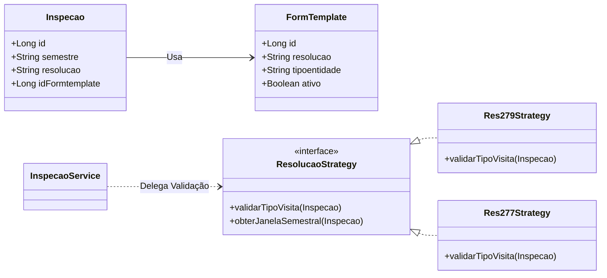
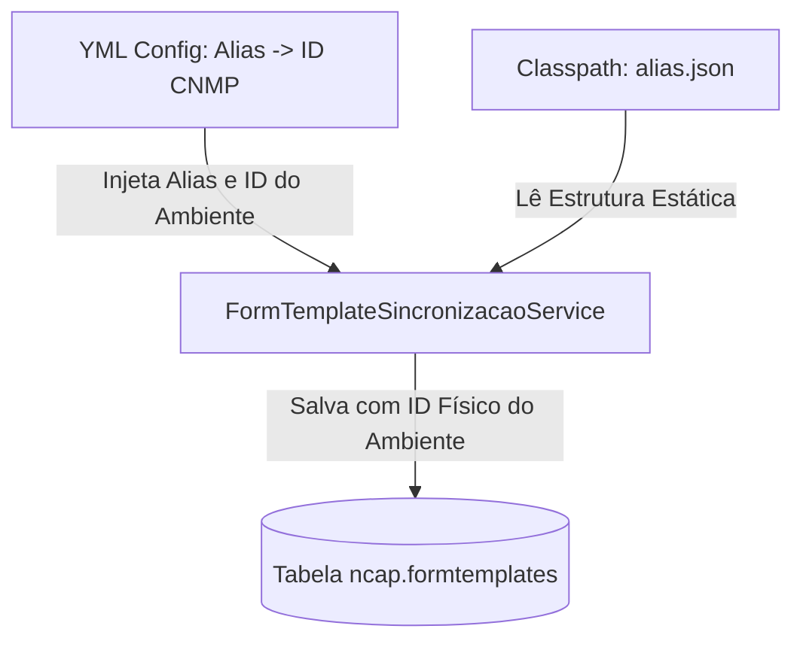

# NCAP • Análise Técnica: Integração Multiambiente e Multiresolução (CNMP)

Este documento descreve a estratégia técnica e arquitetural recomendada para evoluir o sistema **NCAP** no suporte à integração com a API do **CNMP**, especificamente no gerenciamento de múltiplas resoluções concorrentes (ex: Resolução 277 e Resolução 279), parametrização dinâmica de ambientes (Homologação vs. Produção) e sincronização resiliente de entidades e seções de formulários com layouts heterogêneos.

---

## 1. Gestão de Resoluções Distintas (Ex: Resolução 277 vs. Resolução 279)

### O Problema Atual: Colisão por `tipoentidade`
No modelo atual, a seleção do template de formulário para uma nova inspeção baseia-se unicamente no campo `tipoentidade`:
```sql
SELECT id_formtemplate FROM ncap.formtemplates 
WHERE tipoentidade = :tipo AND ativo = true 
ORDER BY criadoem DESC LIMIT 1
```
Se o CNMP publicar atualizações para a **Resolução 277** e a **Resolução 279** que compartilhem tipos de entidades semanticamente semelhantes, ou se houver a necessidade de coexistência das duas resoluções na mesma base, ocorrerá uma **colisão de templates**. O sistema escolherá o template mais recente ignorando a qual resolução a inspeção se refere.

### A Solução Recomendada: Particionamento por Resolução
Para suportar múltiplas resoluções de forma concorrente e isolada, devemos segmentar o ciclo de vida das inspeções e templates:

1. **Campos Adicionais no Modelo de Dados (`FormTemplate` e `Inspecao`):**
   * **`FormTemplate.resolucao`:** Formalizar a coluna de resolução (ex: `"RESOLUCAO_277"`, `"RESOLUCAO_279"`) no banco de dados, para além do campo informativo atual.
   * **`Inspecao.resolucao`:** Garantir que o agendamento da inspeção carregue explicitamente a qual resolução aquela inspeção responde.

2. **Refatoração da Seleção de Templates (`InspecaoService.java`):**
   A query de associação automática deve obrigatoriamente considerar o par `(tipoentidade, resolucao)`:
   ```java
   Long idTemplate = ((Number) entityManager.createNativeQuery(
           "SELECT id_formtemplate FROM ncap.formtemplates " +
           "WHERE tipoentidade = :tipo AND resolucao = :resolucao AND ativo = true " +
           "ORDER BY criadoem DESC LIMIT 1")
           .setParameter("tipo", entidade.getTipoentidade())
           .setParameter("resolucao", inspecao.getResolucao())
           .getSingleResult()).longValue();
   ```

3. **Restrições de Negócio por Resolução (RN01 - Tipo de Visita):**
   Atualmente, as regras do 1º/2º semestre (visitas presenciais obrigatórias no primeiro semestre) estão codificadas diretamente em `InspecaoService` sob a premissa da Resolução 279.
   * **Recomendação:** Externalizar essas validações para um validador específico por resolução (padrão *Strategy*), garantindo que as regras temporais da Resolução 279 não quebrem as inspeções baseadas na Resolução 277 (que podem ter periodicidades ou janelas de vistoria distintas).



---

## 2. Parametrização Dinâmica de Ambientes (Homologação vs. Produção)

### O Desafio: IDs Divergentes entre Ambientes
O CNMP atribui IDs de formulários diferentes para o mesmo questionário em homologação e produção. Por exemplo:
* **Ambiente de Homologação:**
  * Resolução 277 (Prisionais/Cadeias) $\rightarrow$ ID **502**
  * Resolução 279 (Polícia/IML) $\rightarrow$ ID **222**
* **Ambiente de Produção:**
  * Resolução 277 $\rightarrow$ ID **462**
  * Resolução 277 Militar $\rightarrow$ ID **282**
  * Resolução 279 $\rightarrow$ ID **222** (ou outro ID arbitrário)

Se utilizarmos arquivos estáticos no classpath denominados `form_1567.json` e usarmos esses IDs físicos diretamente no código Java, teremos incompatibilidade no momento de promover a aplicação entre ambientes.

### A Solução Recomendada: Mapeamento Lógico por Alias
Para desacoplar a aplicação dos IDs físicos flutuantes do CNMP, sugerimos a introdução de uma camada de tradução baseada em **Chaves Lógicas (Aliases)**.

1. **Configuração via Propriedades (`application.yml`):**
   Em vez de expor uma lista simples de IDs numéricos, definimos um mapeamento de chaves estáveis para os IDs físicos correspondentes de cada ambiente:
   ```yaml
   api:
     cnmp:
       ambiente: ${CNMP_ENV:homologacao} # homologacao | producao
       templates:
         - alias: "TEMPLATE_DELEGACIA_CIVIL"
           resolucao: "RESOLUCAO_279"
           id: ${CNMP_FORM_DELEGACIA_CIVIL:1567}
         - alias: "TEMPLATE_MEDICINA_LEGAL"
           resolucao: "RESOLUCAO_279"
           id: ${CNMP_FORM_MEDICINA_LEGAL:1562}
         - alias: "TEMPLATE_ESTABELECIMENTO_PRISIONAL"
           resolucao: "RESOLUCAO_277"
           id: ${CNMP_FORM_PRISIONAL:1108}
   ```

2. **Renomeação dos Arquivos Estáticos:**
   Os arquivos JSON de template armazenados no repositório deixam de usar IDs numéricos e passam a usar a chave estável:
   * `templates-cnmp/form_1567.json` $\rightarrow$ `templates-cnmp/TEMPLATE_DELEGACIA_CIVIL.json`
   * `templates-cnmp/form_1562.json` $\rightarrow$ `templates-cnmp/TEMPLATE_MEDICINA_LEGAL.json`

3. **Adaptação do `FormTemplateSincronizacaoService`:**
   No startup do sistema ou trigger administrativo:
   * O serviço lê a lista de templates configurados em `application.yml`.
   * Ele carrega o arquivo JSON associado (`TEMPLATE_DELEGACIA_CIVIL.json`) a partir do classpath.
   * Ele substitui dinamicamente o ID do template no banco pelo ID configurado para o ambiente atual.
   * Desta forma, a integridade referencial local funciona de forma transparente em qualquer ambiente.



---

## 3. Sincronização de Entidades e Seções de Formas Dispares

### O Desafio: Estruturas de Entidades e Questionários Heterogêneos
Entidades da Resolução 277 (presídios, cadeias públicas) possuem atributos geográficos e operacionais distintos de unidades da Resolução 279 (delegacias de polícia civil, institutos de medicina legal). Além disso, a árvore de perguntas e seções geradas pelo CNMP varia drasticamente entre esses formulários.

### Estratégias para Sincronização de Entidades
1. **Filtro de Carga por Escopo:**
   O endpoint do CNMP `/entidades?formulario={id}` retorna apenas as entidades elegíveis para aquele formulário específico.
   * **Recomendação:** Na rotina de sincronização, fazer chamadas paginadas para cada ID de formulário configurado no ambiente. Ao salvar na tabela `ncap.entidades`, o sistema deve associar a entidade com as resoluções suportadas por ela para evitar o agendamento de formulários inválidos.

2. **Compatibilização de Tipos de Entidades (`tipoentidade`):**
   Para evitar problemas com alterações de nomenclatura da API do CNMP (que causou o erro `VARCHAR(50)` resolvido recentemente):
   * Assegurar que o banco de dados e as entidades JPA tenham margem segura (`VARCHAR(150)` ou mais).
   * Implementar um mecanismo de normalização de strings durante a importação para evitar que pequenas variações (ex: "Delegacias Estaduais" vs "Delegacias Estaduais - Civil") dupliquem registros locais.

### Estratégias para Renderização Dinâmica de Seções Dispares
Para renderizar formulários com estruturas totalmente diferentes de forma robusta e limpa:

1. **Renderizador Dinâmico Baseado em Metadados (Frontend):**
   * O frontend deve interpretar a estrutura hierárquica salva no banco (`Secao` $\rightarrow$ `Bloco` $\rightarrow$ `Pergunta` $\rightarrow$ `Opcoes`) e renderizar os campos de forma puramente dinâmica usando tipos básicos (Input, Select, Date, Checkbox, TextArea).

2. **Injeção de Lógica customizada via Chaves Estáveis (Indexes/Labels):**
   Para injetar comportamento customizado (ex: cálculos matemáticos automáticos do MPPB ou seletores de dados internos) sem acoplamento com IDs numéricos voláteis:
   * **Frontend Customization Hook:** O componente renderizador dinâmico deve verificar a existência de um mapeamento local para o `indice` (ex: `"2.2.1"`) ou `label` do campo.
   * Se um mapeamento for encontrado, o renderizador padrão é substituído pelo componente rico (ex: seletor de comarcas).
   * **Exemplo de Configuração de Mapeamento no Frontend:**
     ```javascript
     const mppbFormOverrides = {
       "TEMPLATE_DELEGACIA_CIVIL": {
         "1.1": { component: "OrgaoMppbSelector", required: true },
         "2.4": { component: "InputCalculado", formula: "Q2.4.1 + Q2.4.2" }
       }
     };
     ```
