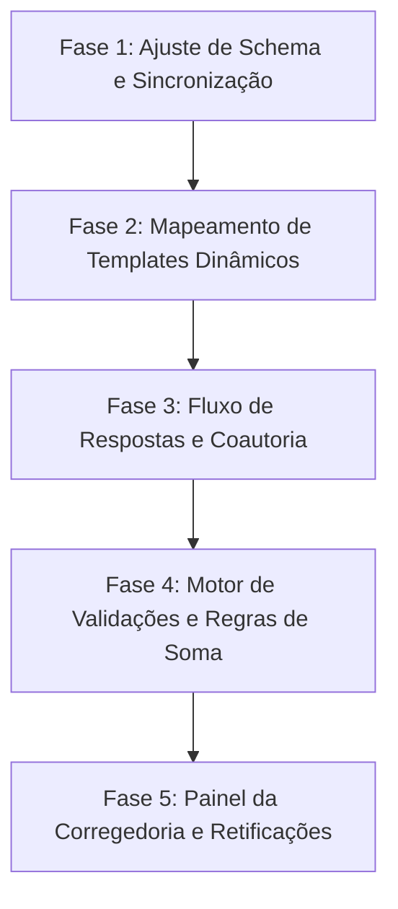

# Plano de Requisitos e Backlog do NCAP (CNMP Res. 277 e 279)

Este documento apresenta o levantamento completo de requisitos do sistema NCAP (Núcleo de Controle da Atividade Policial), baseado no Manual do Usuário e no Manual Técnico das Resoluções CNMP nº 277 e nº 279/2023. Inclui uma comparação detalhada entre o sistema legado (CEAP-360), o protótipo atual do NCAP, e o sistema de produção alvo, bem como o backlog de tarefas estruturado para guiar a implementação.

---

## 1. Mapeamento de Requisitos de Negócio (CNMP)

O cumprimento das Resoluções nº 277/2023 (estabelecimentos prisionais) e nº 279/2023 (unidades policiais civis e militares) é ditado por regras temporais, fluxos de validação rigorosos e atribuições específicas para cada perfil de acesso.

### 1.1 Calendário e Períodos de Referência
As visitas e o preenchimento de relatórios ocorrem de forma semestral:
*   **1º Semestre:**
    *   **Visita:** Deve ser realizada de **janeiro a abril** de forma **exclusivamente presencial**.
    *   **Dados de Referência:** Devem abranger de **1º de julho a 31 de dezembro** do ano anterior.
    *   **Envio pelo Membro:** Até o 5º dia útil do mês subsequente à visita.
    *   **Validação pela Corregedoria:** Até o último dia útil do segundo mês subsequente ao da visita.
*   **2º Semestre:**
    *   **Visita:** Deve ser realizada de **julho a outubro** de forma **presencial ou remota/virtual**.
    *   **Justificativa Remota:** A opção virtual (Art. 1.1.2.1) exige justificativa sob duas condições:
        *   *Opção I:* Presença física impossibilitada por motivo de força maior.
        *   *Opção II:* Unidade fiscalizada por meio de outro procedimento específico instaurado.
    *   **Dados de Referência:** Devem abranger de **1º de janeiro a 30 de junho** do ano corrente.

### 1.2 Perfis de Acesso e Matriz de Permissões
O sistema do CNMP prevê atribuições rígidas para cada ator corporativo:

| Função / Ação | Membro Autor | Membro Coautor | Cadastrador | Corregedoria | Administrador / CSP |
| :--- | :---: | :---: | :---: | :---: | :---: |
| **Gerar/Agendar Formulário** | Sim | Não | Não | Não | Sim |
| **Adicionar/Excluir Coautores** | Sim | Não | Não | Não | Sim (Excepcional) |
| **Preencher Questionário** | Sim | Sim | Sim | Não | Não |
| **Validar Regras de Soma/Obrigatoriedade**| Sim | Sim | Sim | Sim (Visual) | Não |
| **Enviar para Corregedoria** | Sim | Sim | Não | Não | Não |
| **Devolver para Membro (com justificativa)** | Não | Não | Não | Sim | Não |
| **Validar Formulário (Envio Final)** | Não | Não | Não | Sim | Não |
| **Solicitar Retificação (Pós-Validação)** | Sim | Sim | Não | Não | Não |
| **Aceitar/Negar Retificação** | Não | Não | Não | Sim | Não |

### 1.3 Regras Críticas de Preenchimento e Validação
1.  **Impossibilidade de Deixar Campos Numéricos em Branco:**
    *   Se a unidade não dispõe de dados ou a resposta é inexistente, o preenchedor deve informar o numeral `0` (zero) — nunca deixar em branco ou usar sequências de preenchimento (`1111`, `9999`).
    *   **Justificativa de Zeros:** Todo campo numérico "zerado" deve ser explicitamente justificado no campo de **Observações Gerais** ao final do formulário.
2.  **Validação de Soma (Consistência Numérica):**
    *   O total inserido em perguntas consolidativas (ex: total de boletins de ocorrência) deve corresponder obrigatoriamente à soma algébrica dos seus subcampos detalhados nas seções.
3.  **Preservação de Dados de Cadastro:**
    *   Erros de nomenclatura ou endereços de unidades policiais no CNMP não devem ser editados pelo preenchedor; devem ser solicitados via chamado técnico para a CSP/CNMP.

---

## 2. Comparativo: CEAP-360 (Legado) vs. Protótipo vs. NCAP Alvo

A transição de um sistema legada baseado em Firestore para um sistema relacional robusto exige ajustes de modelo e lógica.

| Critério Arquitetural | CEAP-360 (Legado) | NCAP (Protótipo Inicial) | NCAP (Produção Alvo) |
| :--- | :--- | :--- | :--- |
| **Banco de Dados** | Firestore (NoSQL) | PostgreSQL + H2 | PostgreSQL (com DDL-auto: `none` em prod) |
| **Sincronização de Unidades** | Executado por formulário do CNMP; matching frágil por nome de string. | Sincronização em background; matching por nome normalizado. | **Sincronização via ID Único (`id_cnmp`)** com fallback de nome normalizado para retrocompatibilidade. |
| **Status das Unidades** | Boolean simples na coleção. | Boolean `ativa` na tabela `unidades`. | Estado ativo/inativo sincronizado da API; unidades inativas são ocultadas no agendamento, mas preservadas no histórico. |
| **Definição de Formulários** | Estruturas fixas JSON nos scripts de resposta. | Tabelas relacionais (`formtemplates`, `perguntas`, `opcoesresposta`). | Hierarquia relacional dinâmica; carregamento sob demanda baseado no `tipoentidade` da unidade. |
| **Controle de Fluxo/Estados** | Estados implícitos na resposta do Firestore. | Status simples (`AGENDADA` a `CONCLUIDA`). | **Fluxo de Tramitação Completo (8 Estados):** `AGENDADA`, `EM_PREENCHIMENTO`, `AGUARDANDO_VALIDACAO`, `DEVOLVIDO`, `VALIDADO`, `SOLICITADA_RETIFICACAO`, `RETIFICACAO_ACEITA`, `RETIFICACAO_NEGADA`. |
| **Coautoria de Relatórios** | Não implementado (apenas 1 autor). | Não implementado (apenas equipe MPPB em lista textual). | **Tabela de Vínculo de Coautores (`inspecao_coautores`)** com gating de permissão no backend/frontend. |
| **Justificativa Remota** | Não mapeado (Resolucões antigas). | Mapeado no DTO de agendamento de inspeção. | Integração do artigo correspondente da Res. 279 no agendamento e submissão final da instância. |

---

## 3. Backlog Consistente de Implementação (NCAP)

Para conduzir a implementação de forma ordenada, o backlog foi estruturado em 5 fases lógicas.

### 📌 Fase 1: Ajuste de Schema e Sincronização
*   [x] **F1-A:** Alterar tabela `ncap.unidades` para comportar `id_cnmp` (BIGINT UNIQUE).
*   [x] **F1-B:** Criar índice único `idx_unidades_idcnmp` para otimização de buscas no PostgreSQL.
*   [x] **F1-C:** Atualizar lógica de `UnidadeSincronizacaoService` para usar `id_cnmp` como chave primária de reconciliação, aplicando fallback por nome normalizado caso o ID esteja nulo localmente (backfill automático).
*   [x] **F1-D:** Atualizar testes de integração de sincronização para validar o mapeamento de ID e inativação de unidades órfãs.

### 📌 Fase 2: Mapeamento de Templates Dinâmicos de Formulários
*   **F2-A (Backend):** Implementar ou verificar o mapeamento JPA para `FormTemplate`, `Secao`, `Bloco`, `Pergunta`, e `OpcaoResposta` com relacionamentos do tipo `@OneToMany` (carregamento LAZY) e cascateamento adequado.
*   **F2-B (Backend):** Criar `FormTemplateRepository` para buscar templates ativos filtrados por `resolucao` (Res. 277 ou 279) e `tipoentidade` (ex: delegacias civis vs. estabelecimentos prisionais).
*   **F2-C (Backend/Integração):** Criar job de importação periódica de templates oficiais a partir do endpoint `/formularios?ambiente={id}` do CNMP.
*   **F2-D (Frontend):** Ajustar listagem de templates e sua associação automática na tela de agendamento de inspeção (`InspecaoFormView.vue`).

### 📌 Fase 3: Fluxo de Respostas e Coautoria
*   **F3-A (Backend):** Alterar tabela `ncap.inspecoes` para incluir o relacionamento com `id_formtemplate` (chave estrangeira).
*   **F3-B (Backend):** Criar tabela associativa `ncap.inspecao_coautores` (`id_inspecao`, `id_servidor_coautor`) para persistir membros coadjuvantes.
*   **F3-C (Backend/Segurança):** Implementar filtros e permissões de segurança para que o preenchimento de respostas (`RespostasInspecao`) seja permitido apenas ao Membro Autor, aos Coautores cadastrados, ou a um perfil Cadastrador associado.
*   **F3-D (Frontend):** Adicionar painel de "Gerenciar Coautores" na visualização do agendamento (conforme Tópico 20.3 do manual), permitindo adicionar e remover servidores de cargo `membro` ativos.

### 📌 Fase 4: Motor de Validações e Regras de Soma
*   **F4-A (Backend):** Desenvolver o motor de validação de regras de soma (`RegraSomaValidador.java`), que verifica se as respostas numéricas de subitens batem com as consolidadas antes de permitir o envio para a Corregedoria.
*   **F4-B (Backend):** Validar campos obrigatórios vazios ou não informados, forçando o uso do `0` e gerando alertas caso a justificativa de zeros no campo de observações gerais esteja em branco.
*   **F4-C (Frontend):** Criar uma visualização ou aba lateral "Validar Preenchimento" na tela de respostas da inspeção para expor pendências em tempo real (campos obrigatórios vazios e erros de soma).

### 📌 Fase 5: Painel da Corregedoria e Fluxo de Retificações
*   **F5-A (Backend):** Implementar a máquina de estados para o ciclo de vida da inspeção:
    *   *Enviar para Corregedoria:* Muda status para `AGUARDANDO_VALIDACAO`.
    *   *Devolver:* Exige campo `justificativa_devolucao` e muda status para `DEVOLVIDO`.
    *   *Validar:* Exige `justificativa_atraso` se fora do prazo regulamentar do calendário e muda status para `VALIDADO`.
    *   *Solicitar Retificação:* Abre prazo de edição e muda status para `SOLICITADA_RETIFICACAO`.
*   **F5-B (Frontend):** Desenvolver a tela de visualização de inspeções do perfil **Corregedoria**, permitindo ler o formulário com destaque nas justificativas de zeros e observações gerais, e acionar os botões "Validar" e "Devolver".
*   **F5-C (Backend/Integração):** Implementar o serviço de transmissão da instância validada para a API oficial do CNMP (chamada HTTP `POST /instancias`), capturando o recibo de entrega e salvando-o localmente para fins de auditoria.
*   **F5-D (Frontend):** Criar o painel "Monitorar Envio de Formulários" com filtros por Ano, Semestre, e Status para controle de remessa e conformidade pelas Corregedorias.
