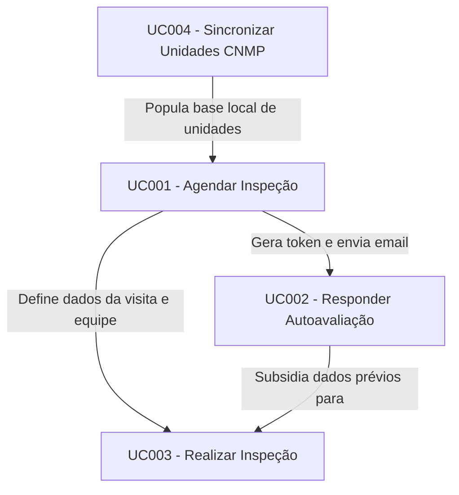

# Especificações e Requisitos - NCAP

Este diretório contém a especificação técnica e funcional das funcionalidades do sistema NCAP, garantindo a rastreabilidade dos requisitos e suas dependências.

## 🗺️ Mapa de Casos de Uso & Rastreabilidade

Abaixo está o fluxo e a relação de dependência entre as funcionalidades:

---

## 🗂️ Índice de Casos de Uso

| ID | Nome do Caso de Uso | Descrição Resumida | Depende de | Status |
| :--- | :--- | :--- | :--- | :--- |
| **[UC001](UC001-Agendar-Inspecao.md)** | **Agendar Inspeção** | Registro de agendamento contendo PGA, tipo de visita (com justificativa da Res. 279/2023 se remota), equipe MPPB e data limite. | UC004 | 📝 Pronto para Codificação |
| **UC002** | **Responder Autoavaliação** | Preenchimento pelo gestor da unidade policial dos dados sobre infraestrutura e contingente via token exclusivo. | UC001 | ⏳ Planejado |
| **[UC003](UC003-Realizar-Inspecao.md)** | **Realizar Inspeção** | Coleta de dados presenciais ou virtuais pela equipe do MPPB comparando com a autoavaliação, auditoria técnica e retificação assistida. | UC001, UC002 | 🟢 Implementado |
| **[UC004](UC004-Sincronizar-Unidades.md)** | **Sincronizar Unidades Policiais** | Importação e atualização das unidades a partir da API oficial do CNMP. Suporta edição de alcunha local (sem sobrescrita na sincronização). | Nenhum | ⏳ Planejado |

---

## ⚙️ Diretrizes Gerais de Implementação
* **Frontend:** Implementado utilizando Vue 3, Vuetify 3 e Pinia.
* **Backend:** Implementado utilizando Spring Boot 3, JPA/Hibernate, e banco de dados H2/PostgreSQL.
* **Histórico de Alterações:** Qualquer mudança de escopo no sistema deve ser precedida pela atualização correspondente do seu arquivo `.md` de especificação neste diretório.
